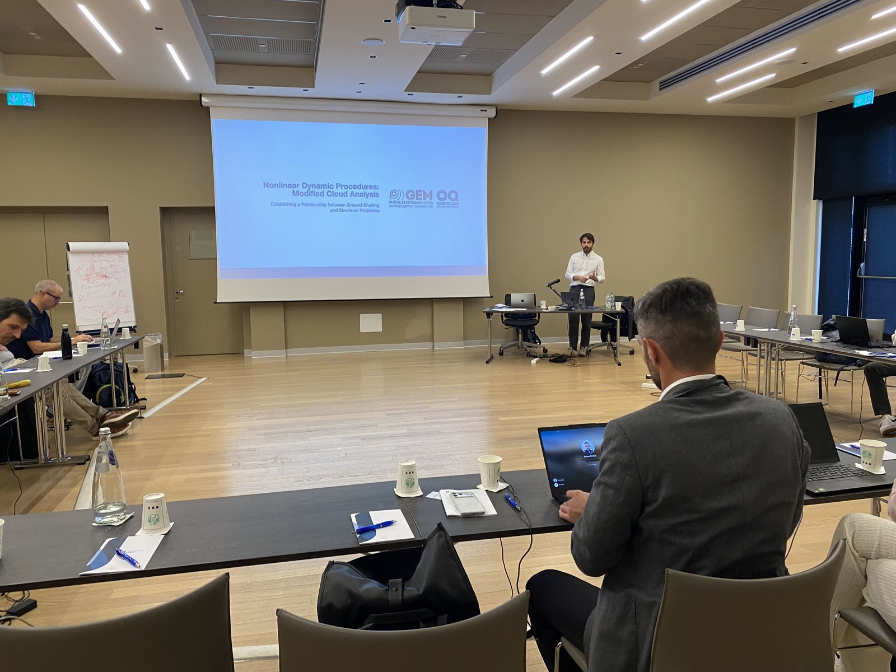
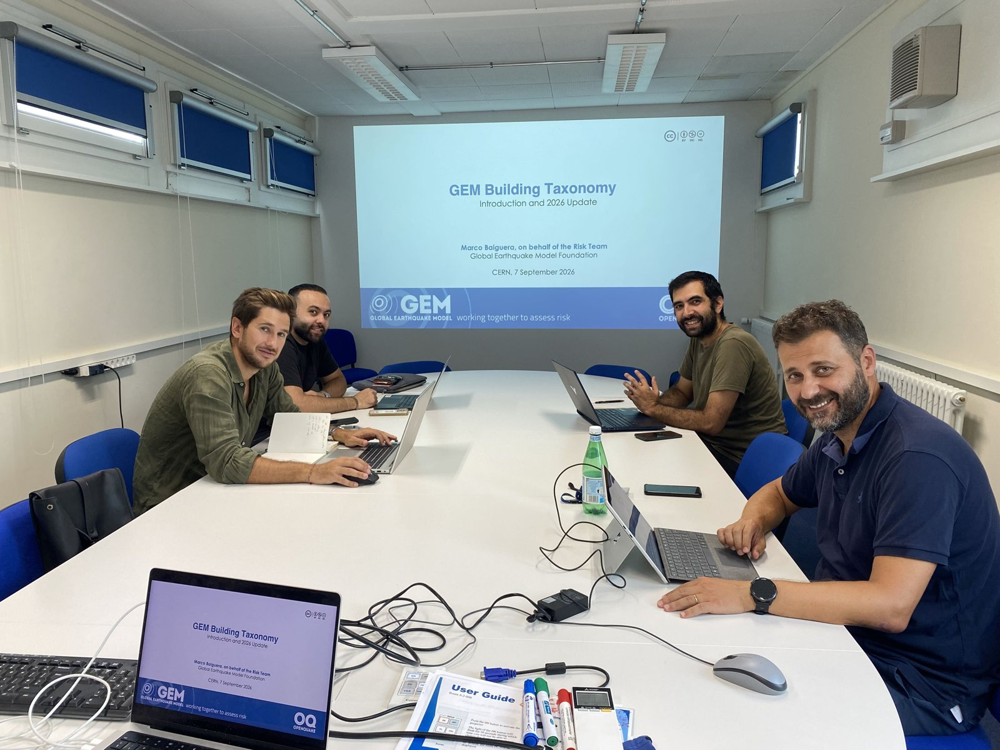
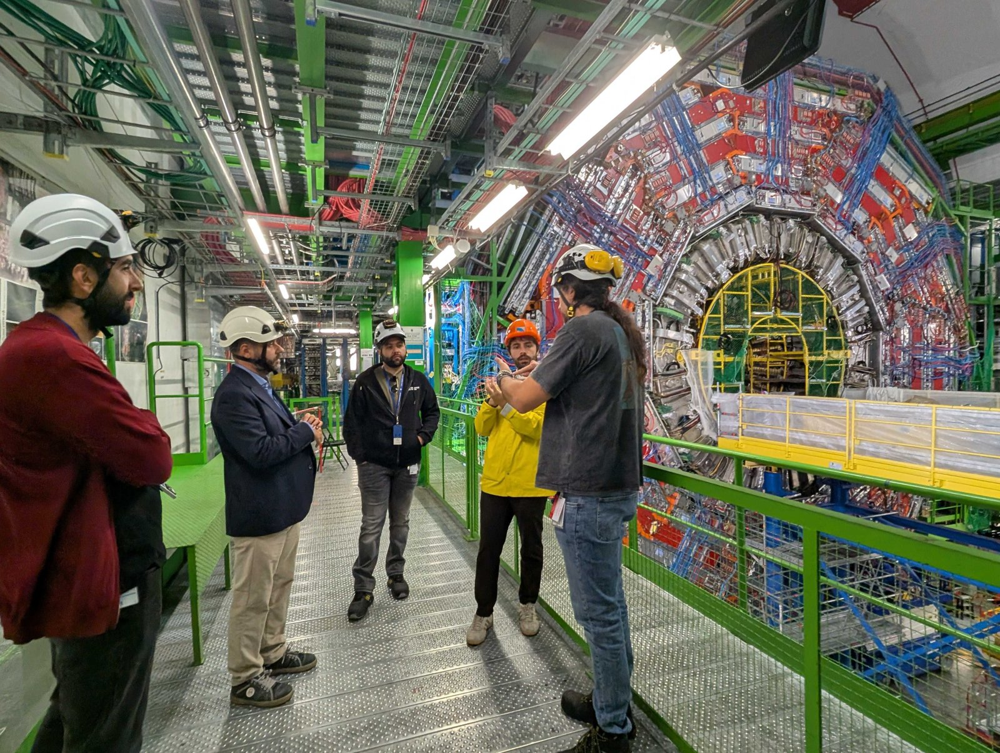
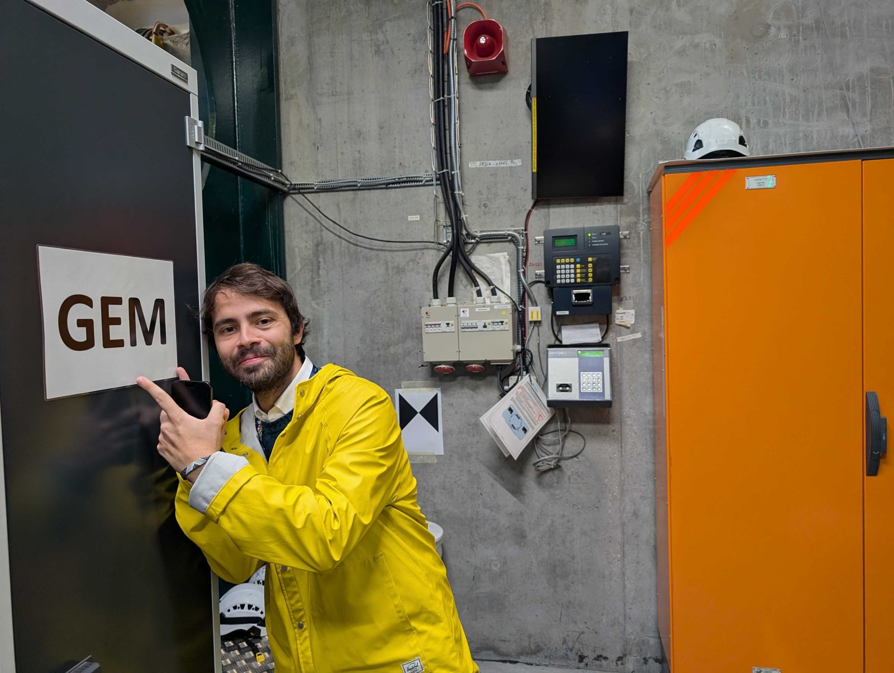
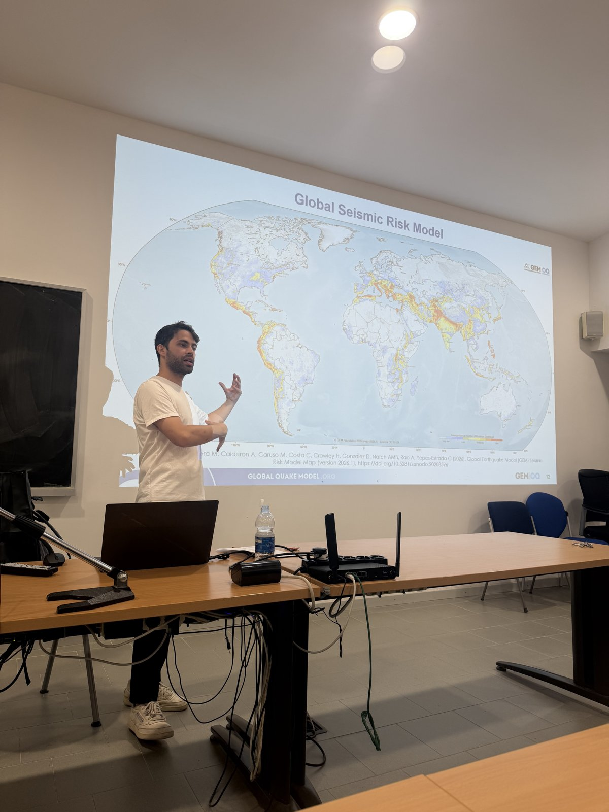
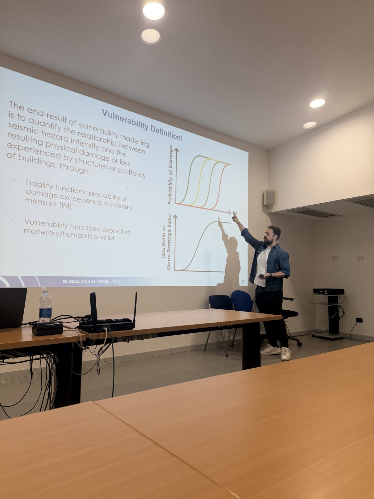
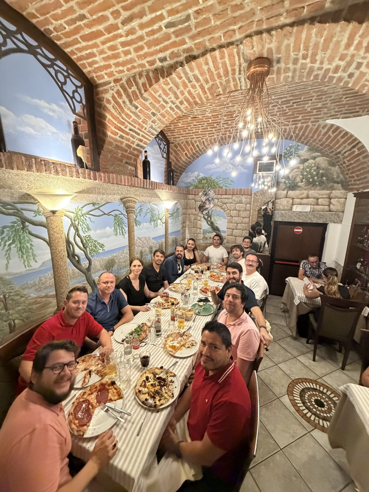
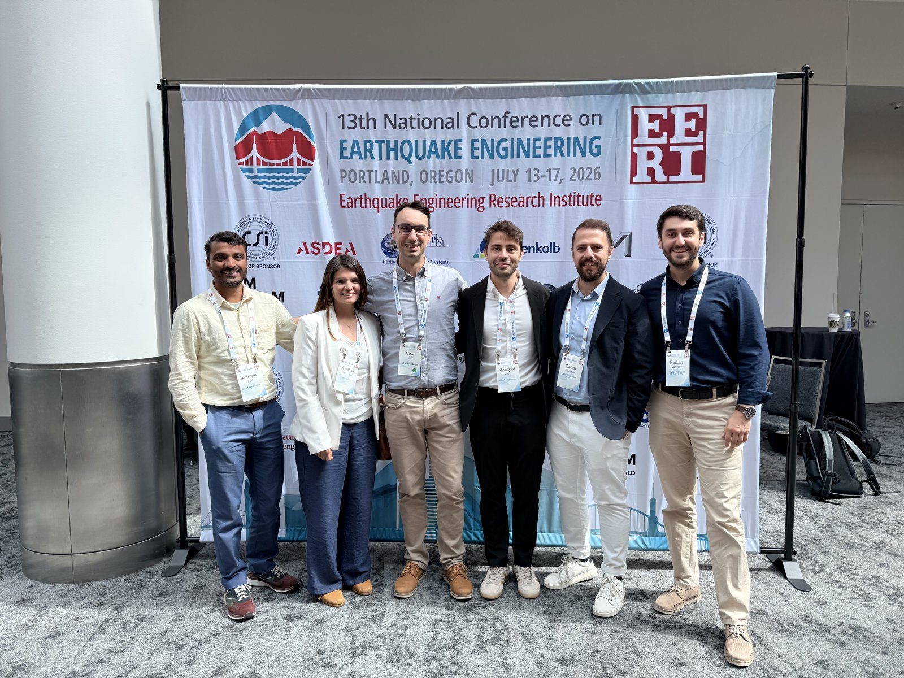

[Al Mouayed Bellah Nafeh](https://www.linkedin.com/in/al-mouayed-bellah-nafeh/) (b. 1993) earned his B.Sc. in Civil and Environmental Engineering from the University of Balamand, Lebanon (2015), where he completed a thesis on finite element analysis of structural steel elements. He then gained early professional experience on infrastructure and high-rise residential projects in Lebanon.

In 2017, he graduated from the European Commission’s Erasmus Mundus [MEEES](https://www.preventionweb.net/resource/erasmus-master-earthquake-engineering-and/or-engineering-seismology-meees) programme with an M.Sc. in Earthquake Engineering and Engineering Seismology, following studies at Université Grenoble-Alpes (France) and Istituto Universitario di Studi Superiori IUSS Pavia (Italy). He subsequently pursued a two-year research fellowship at Università degli Studi di Pavia and IUSS Pavia, funded by [ReLuis](https://www.reluis.it/en/) and [ITERATE](https://civil-protection-humanitarian-aid.ec.europa.eu/funding-evaluations/financing-civil-protection/prevention-and-preparedness-projects-civil-protection/overview-past-track-i-and-track-ii-projects/improved-tools-disaster-risk-mitigation-algeria-iterate_en) consortia.

In 2023, he was awarded a Ph.D. in Earthquake Engineering from IUSS Pavia, and graduated with a Cum Laude. His doctoral research addressed advancements in risk- and loss-based methodologies for large-scale assessment of non-ductile infilled reinforced concrete buildings.

Currently, he is the Physical Vulnerability Lead at the [Global Earthquake Model (GEM) Foundation](https://www.globalquakemodel.org/gem-team/mouayed-nafeh), where he leads efforts to assess regional seismic vulnerability and support risk transfer strategies. He is the primary developer of the [OpenQuake Vulnerability Modeller’s Toolkit](https://gemsciencetools.github.io/oq-vmtk/) and the [Global Seismic Vulnerability Model](https://docs.openquake.org/vulnerability/), maintained by the GEM Foundation.

His primary research interests centre on the seismic vulnerability modelling and assessment of regional building portfolios, spanning response to mainshock only as well as damage accumulation under earthquake sequences and empirical validation of models that support both economic and human-centric loss estimation bridging applications in academia, industry, and disaster risk reduction.

## News

**November 2026:** Call for abstracts! Al Mouayed Bellah Nafeh, Karim Aljawhari and Furkan Narlitepe are organizing the minisymposium "Advancing Seismic Fragility and Vulnerability Modelling for Regional Risk Applications: Development, Validation, and Tools" (MS-53-COF) at COMPDYN 2027, the 11th International Conference on Computational Methods in Structural Dynamics and Earthquake Engineering (13–16 June 2027, Hersonissos, Crete, Greece). The session explores the development, validation and application of seismic fragility, vulnerability and consequence models, from analytical, empirical and hybrid methods to post-earthquake validation and open-source tools. Researchers and practitioners are invited to submit their abstracts under session code **MS-53-COF**; abstract submission is open until **November 30th**. [[Flyer](https://mouayed-nafeh.github.io/files/Special_Sessions/compdyn-flyer-2027.pdf)]

**September 2026:** Al Mouayed Bellah Nafeh (Physical Vulnerability Lead) and Marco Baiguera (Exposure Analyst) led the second part of GEM's two-part training programme on seismic hazard and risk assessment in Italy, held at Unipol in Bologna from 30 September to 1 October. This part covered exposure characterisation, including building locations and characteristics, and physical vulnerability assessment using nonlinear dynamic analysis. It followed the first part in July, led by GEM Seismic Hazard Scientists Christopher Brooks and Francesco Serafini, which covered seismic hazard, ground-motion modelling and hazard model testing. Together, the two parts span key components of earthquake risk modelling, supporting the assessment of potential damage and losses.

**September 2026:** The GEM Team, represented by Al Mouayed Bellah Nafeh (Physical Vulnerability Lead), Anirudh Rao (Seismic Risk Lead) and Marco Baiguera (Exposure Analyst), visited the CERN facilities in Meyrin, Switzerland, for a two-week workshop on exposure, vulnerability and earthquake risk applications using the OpenQuake Engine. Many thanks to the CERN Team for the great welcome!

**July 2026:** And that's a wrap! The GEM Models and OpenQuake Engine Training course on Vulnerability Modelling at IUSS Pavia has concluded. Taught by Al Mouayed Bellah Nafeh and Karim Aljawhari from the GEM Foundation within the Doctoral Programme in Earthquake Engineering, the two-week course (20–31 July 2026) combined lectures with hands-on tutorials on the OpenQuake Vulnerability Modeller's Toolkit, culminating in a case study in the OpenQuake Engine. Thanks to all the students for their engagement and hard work throughout the course! [[Syllabus](https://mouayed-nafeh.github.io/files/Courses/GEM_Models-Course-Syllabus-2026.pdf)]

**July 2026:** The GEM hazard and risk teams were at the 13th National Conference on Earthquake Engineering (13NCEE), held at the Oregon Convention Center in Portland, Oregon, from 13 to 17 July 2026, where they presented the latest advancements and products in the hazard, vulnerability and risk spaces.

**June 2026:** The GEM Conference 2026 brought together researchers, practitioners and partners of the Global Earthquake Model (GEM) Foundation to share the latest advances in global earthquake hazard and risk modelling. Al Mouayed Bellah Nafeh, Physical Vulnerability Lead at the GEM Foundation, presented the release of the v2026.0.0 Global Seismic Vulnerability Model. [[YouTube](https://www.youtube.com/watch?v=seHuyApKLpc&t=2s)]

